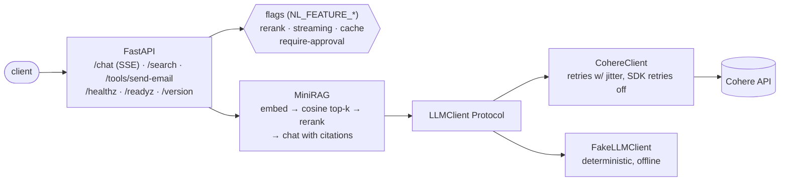
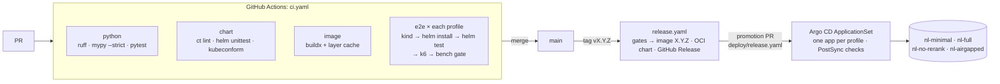

# north-lite

A small North-style LLM service, plus the **developer-experience platform** around
it: the test and deploy automation that lets a team ship an AI product safely
across many feature-flag combinations.

The service is FastAPI on the Cohere API (Command A+ chat with citations, Embed v5,
Rerank v5). The platform is the point: a Helm chart, an environment per flag
profile in CI and in GitOps, LLM evals with a simulated user, benchmark regression
gates, and a release process with real rollback.

[](https://github.com/dbourdon/north-lite/actions/workflows/ci.yaml)

## What it demonstrates

| Need | How it's done here |
|---|---|
| Environments with specific feature-flag combinations | One `values-flags-<profile>.yaml` per combination. CI creates a kind cluster per profile; Argo CD creates an Application per profile. Both discover the files, so a new file is a new environment |
| Tests that don't depend on the LLM | `LLMClient` Protocol with a deterministic fake backend: 86 tests in ~3 s, no key, no quota |
| Environments that verify themselves | A flag-aware `helm test` pod (also an Argo PostSync hook) checks the live service matches its profile; an egress test proves the air-gapped profile really can't reach the internet |
| LLM quality in CI | Eval harness: a simulated user (scripted, or Command A+ with a persona) asks 20 questions; gate on retrieval hit rate ≥ 0.85 |
| Performance regressions | k6 in every e2e environment; a TypeScript GitHub Action fails on p95 > +15% **and** > +20 ms vs a per-profile baseline |
| Safe releases | Tag-driven release with gates, immutable images, OCI chart, GitOps promotion PR, rollback = revert |

## Architecture





## Quick start (no cluster, no API key)

```bash
git clone https://github.com/dbourdon/north-lite && cd north-lite
uv sync
uv run pytest -n auto                       # 86 offline tests
NL_BACKEND=fake uv run north-lite serve &   # API docs: http://127.0.0.1:8000/docs
uv run north-lite eval                      # simulated-user eval against it
```

## Proof (real CI runs)

| What | Run |
|---|---|
| All flag profiles deployed and verified on kind, incl. air-gapped egress blocked (Calico) | [44617034918](https://github.com/dbourdon/north-lite/actions/runs/44617034918) |
| Bench gate catches a deliberate 50 ms regression in all 4 environments (+51 ms), while 83 unit tests still pass | [44804095292](https://github.com/dbourdon/north-lite/actions/runs/44804095292) |
| Noise floor: `no-rerank` p95 +31.7% but +1.0 ms → passes (a %-only gate would flake) | [44803398163](https://github.com/dbourdon/north-lite/actions/runs/44803398163) |
| First release: gates, immutable image `0.1.0`, OCI chart, GitHub Release | [v0.1.0](https://github.com/dbourdon/north-lite/releases/tag/v0.1.0) · [44787685244](https://github.com/dbourdon/north-lite/actions/runs/44787685244) |
| Live eval (real Cohere backend, Command A+ as the user) | hit rate 95%, citation coverage 90%, precision 97%, answer accuracy 95% |

## Design decisions

1. **The LLM sits behind a Protocol, with a fake backend.** CI and every Kubernetes
   test run without a key, without network and without rate limits, and the fake is
   realistic enough (hashed bag-of-words embeddings) for retrieval tests to mean
   something. Real-API tests are marked `live` and run on demand.
2. **Flags are Helm values, and an environment is a values file.** Values → ConfigMap
   → `NL_*` env vars; a checksum annotation rolls pods when they change. CI's
   matrix and Argo's ApplicationSet both discover the profile files, so there is one
   list of environments, not three.
3. **Fail at render time, not deploy time.** `values.schema.json` rejects typos
   (`features.rerak`) and bad types; templates `fail` on unsafe combinations (real
   backend without a key; air-gapped with an external API).
4. **Environments must prove what they are.** Deploying isn't verifying: test pods
   check streaming, rerank and cache behaviour against the profile's flags, and run
   as Helm tests *and* Argo PostSync hooks (Argo doesn't run Helm tests).
5. **Benchmarks gate on relative and absolute change.** Per-profile baselines from
   CI hardware; p95 must grow > 15% *and* > 20 ms to fail, so millisecond jitter on
   a 3 ms baseline can't break builds.
6. **Releases are immutable; promotion is a PR.** `X.Y.Z` images are never re-pushed,
   so reverting the promotion PR really restores the old code. `GET /version` shows
   what's running.
7. **One retry policy, owned by us.** Backoff with full jitter, honouring
   `Retry-After`; the SDK's own retries are off so attempts don't multiply. Bulk
   callers (the eval) also pace themselves, because a per-minute quota can't be
   fixed by short retries.

## Lessons from building it

- **A policy that exists isn't a policy that's enforced.** kind's default CNI
  accepted the NetworkPolicy and ignored it, locally and on GitHub runners. The
  egress test caught it; CI now runs NetworkPolicy profiles on Calico.
- **Green unit tests don't prove an artifact works.** The bench-gate action, first
  written by Cohere's North Mini Code, passed typecheck and tests but couldn't run
  (ESM/CJS mismatch, invalid `action.yml`). The fix added checks that execute the
  built bundle. See [docs/day9-north-mini-code.md](docs/day9-north-mini-code.md).
- **Read the 429, not just the docs.** The trial key's limit is 20 calls/min in
  total, not per endpoint, and sends no `Retry-After`; see
  [docs/cohere-usage.md](docs/cohere-usage.md).
- **Map upstream failures honestly.** A Cohere 422 surfaced as a bare 500; LLM
  errors now return 502, rate limits 503 with `Retry-After`.

## What I'd do next

- Terraform for a real cloud cluster, with External Secrets for the API key.
- A nightly workflow: live-API eval and benchmarks against the real backend.
- Pairwise or risk-based flag-combination selection once there are more flags than
  a full matrix can afford, with the full matrix nightly.
- An LLM test agent that explores flag combinations and writes new eval cases.
- Benchmarks: median of several runs, and baselines refreshed by an automated PR.
- Supply chain: pin actions by SHA (Renovate), sign images (cosign), attach an SBOM.

---

## Reference

### CI

`.github/workflows/ci.yaml` runs on every PR and push to `main`:

| Job | What it checks |
|---|---|
| `python` | ruff, `mypy --strict`, `pytest -n auto -m "not live"` (fake backend: no key, no quota) |
| `chart` | `ct lint` (yamllint, schema, Chart.yaml version bump on PRs), `helm unittest` (24), kubeconform on every flag profile |
| `bench-gate-action` | the TypeScript action: typecheck, 10 unit tests, committed `dist/` matches the source |
| `image` | Docker build with the GitHub Actions layer cache; pushed to GHCR only from `main` |
| `release-pin` | the image pinned in `deploy/release.yaml` exists in GHCR |
| `e2e (<profile>, <cni>)` | one leg per `values-flags-*.yaml`: kind cluster, `helm install`, `helm test`, k6, bench gate. Diagnostics uploaded on failure |

`e2e` waits for `chart`; everything else runs in parallel. The kind setup is a
reusable composite action, `.github/actions/setup-kind-env` (`cni: kindnet|calico`).

Run the same checks locally: `uv run pytest -n auto`, `ct lint --config ct.yaml --all`,
`helm unittest charts/north-lite`, `scripts/validate-chart.sh`.

### Run locally

```bash
uv sync
uv run pytest -n auto                      # offline tests, no API key needed
NL_BACKEND=fake uv run north-lite serve    # http://127.0.0.1:8000/docs
uv run pytest -m live                      # real API (needs CO_API_KEY in env or .env)
uv run north-lite stream "Explain Helm in one sentence."
uv run north-lite rag "Can I deploy on a Friday?"
```

### Container and local cluster

```bash
docker build -t north-lite:dev .           # multi-stage, non-root (UID 10001), ~200 MB
docker run --rm -p 8000:8000 -e NL_BACKEND=fake north-lite:dev

kind create cluster --name nl --image kindest/node:v1.33.1
kind load docker-image north-lite:dev --name nl
```

The node image is pinned to Kubernetes 1.33 because Docker Desktop on this WSL
kernel uses cgroup v1, which newer kubelets refuse to run on. With cgroup v2
(see `docker info | grep -i cgroup`) the default kind image works.

### Deploy with Helm

```bash
# Fake backend: no key needed
helm upgrade --install nl charts/north-lite -n nl --create-namespace \
  -f charts/north-lite/values-ci.yaml --wait

# Flip a flag: the ConfigMap changes, its checksum annotation rolls the pods
helm upgrade --install nl charts/north-lite -n nl --reuse-values --set features.rerank=false --wait
helm history nl -n nl
helm rollback nl 1 -n nl --wait

# Real backend with a pre-created Secret (preferred over apiKey.value)
kubectl -n nl create secret generic cohere-api-key --from-literal=CO_API_KEY="$CO_API_KEY"
helm upgrade --install nl charts/north-lite -n nl \
  --set config.backend=cohere --set apiKey.existingSecret=cohere-api-key --wait
```

Rendering fails early if `config.backend=cohere` has no key source. Pods roll on
ConfigMap changes and on chart-created Secret changes; a change inside an
`existingSecret` needs `kubectl rollout restart` (the chart can't hash a Secret it
doesn't render). If you build the Secret from `.env` with `--from-env-file`, strip
quotes first: kubectl keeps them, python-dotenv doesn't.

### Flag profiles and chart tests

Each environment is `values-ci.yaml` (fake backend, local image) plus one profile:

| Profile | rerank | streaming | cache | Network |
|---|---|---|---|---|
| `minimal` | off | off | off | open |
| `full` | on | on | on | open |
| `no-rerank` | off | on | on | open |
| `airgapped` | on | on | off | all egress denied (NetworkPolicy) |

```bash
helm lint charts/north-lite --strict -f charts/north-lite/values-ci.yaml
helm unittest charts/north-lite              # render-level assertions (24)
uv run pytest tests/test_chart.py            # checksum changes, schema, packaging, versions

p=full
helm upgrade --install nl-$p charts/north-lite -n nl-$p --create-namespace \
  -f charts/north-lite/values-ci.yaml -f charts/north-lite/values-flags-$p.yaml --wait
helm test nl-$p -n nl-$p --logs              # checks the live service matches its flags
```

The air-gapped egress check needs a CNI that enforces NetworkPolicy. CI uses
Calico for that profile (`deploy/kind/calico.yaml`, `scripts/install-calico.sh`);
Calico doesn't start on this host's WSL 5.15 kernel, so that check is CI-only.

### Benchmarks

```bash
BASE_URL=http://127.0.0.1:8000 SUMMARY=out.json k6 run loadtest/chat.js
```

`loadtest/chat.js` runs a constant 20 req/s mix of `/search` and RAG `/chat`
(thresholds: p95 < 300 ms, errors < 1%). In CI it runs in every e2e environment;
`.github/actions/bench-gate` then compares p95 with
`loadtest/baselines/<profile>.json` and writes a table to the job summary.

### Evals

```bash
uv run north-lite eval                                   # scripted user: free, deterministic
uv run north-lite eval --simulator llm --concurrency 1 --pace-s 16 --out report.json
```

`evals/handbook.jsonl` has 20 questions worded differently from the docs. With
`--simulator llm`, Command A+ plays a new engineer that knows only its goal, not the
expected answer, so its "satisfied" verdict is independent of the keyword checks.
A live run costs ~100–140 calls (`docs/cohere-usage.md`).

### GitOps: Argo CD

```bash
scripts/install-argocd.sh                 # Argo CD v3.6.2 into the current context
scripts/argocd-connect-repo.sh            # read-only deploy key (while the repo is private)
kubectl apply -f deploy/argocd/appset.yaml
kubectl -n argocd get applications
```

Argo renders with `helm template` and applies the manifests itself, so `helm list`
shows nothing and rollback is a git revert (or `argocd app rollback` with auto-sync
off). Self-heal reverts manual `kubectl` edits within seconds.

### Releases, promotion and rollback

A release is a `vX.Y.Z` tag on `main`. The release workflow checks the tag matches
the app and chart versions, that CI passed on that commit and that the image tag
is new, then publishes an immutable image, the chart (OCI) and a GitHub Release.
The Argo CD environments run whatever `deploy/release.yaml` pins: promotion is a PR
changing that tag (CI verifies the image exists), rollback is reverting it.
Checklist and rollback runbook: [docs/RELEASING.md](docs/RELEASING.md).

### Configuration

| Env var | Default | Meaning |
|---|---|---|
| `CO_API_KEY` | – | Cohere API key (never commit it) |
| `NL_BACKEND` | `cohere` | `cohere` or `fake` (deterministic, offline) |
| `NL_FEATURE_RERANK` | `true` | rerank search results |
| `NL_FEATURE_STREAMING` | `true` | allow `POST /chat?stream=true` (SSE) |
| `NL_FEATURE_CACHE` | `false` | in-process LRU cache for `/search` and `/chat` |
| `NL_REQUIRE_APPROVAL` | `true` | `POST /tools/send-email` waits for human approval |
| `NL_MAX_ATTEMPTS` | `4` | tries per API call (backoff with full jitter) |
